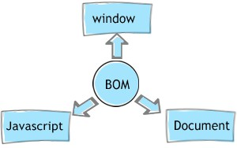

# El BOM o Browser Objets Model 
el BOM es lo que no permite poder entrar a alguna pestaña del navegador o vernuestro historial de busquedas del navegador, el BOm tambien es el encargado de los mensajes o alerts que nos dice el navegador, tambien el sabe de que tamaño es tu pantalla juto con el dispositivo desde el que estas

### que hace el BOM en el navegador
- mandar alerts o mensajes
- nos permite modificar o editar la url en la que estamos
- el BOM sabe en que dispositivo estas lo cual permite para los juegos cambiar sus controles 
- este tambien sabe el tamaño de tu pantalla esto ayuda a que las pantallas para cada dispositivo se acomoden segun su tamaño

# Diferencias entre DOM y BOM en JavaScript

La diferencia principal radica en su propósito: el **DOM** controla el contenido que se renderiza dentro de la página web, mientras que el **BOM** controla la ventana del navegador que aloja dicha página.

---

## Tabla Comparativa Directa

| Característica | DOM (Document Object Model) | BOM (Browser Object Model) |
| :--- | :--- | :--- |
| **¿Qué representa?** | Los elementos **dentro** de la página web. | El **navegador** en sí (el cascarón exterior). |
| **Objeto principal** | `document` | `window` |
| **Elementos que maneja** | Textos, imágenes, botones, formularios, etiquetas HTML. | Historial, barra de direcciones (URL), alertas, tamaño de la ventana, cookies. |
| **Jerarquía** | Está **dentro** del BOM. El objeto `document` es una propiedad de `window`. | Es el nivel más alto. Envuelve a todo lo demás. |
| **Estándar oficial** | Sí, está regulado globalmente por la **W3C**. | No tiene un estándar oficial estricto, funciona por convención entre navegadores. |

---

## 🔍 Relación Jerárquica

En JavaScript, el navegador organiza todo como un árbol de objetos. El **BOM contiene al DOM**:

